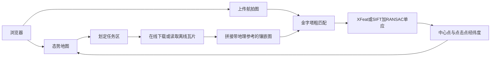

# 航拍图对瓦片地图定位（Windows 完整方案）

## 要不要 3588

不要。本期匹配全部在 CPU 上完成，不用瑞芯微 NPU，也不用 NVIDIA GPU。Windows 10/11 的台式机或笔记本就能开发和运行，x86 上 OpenCV 与 CPU 版 PyTorch 通常比 3588 的 A76 核更快，安装也更省事。

3588 只在以后有现场部署需求，或要改成 RKNN 走 NPU 时才用得上。同一套 Python 代码以后可以拷到板子上；第一版只针对 Windows。

## 能做到什么

用户在态势地图上画出任务区（大约 5 km 见方这一量级），系统只在该区域的卫星瓦片里搜索。上传一张近垂直航拍图后，返回：

- 图像中心对应的地面经纬度
- 照片四角覆盖的地面范围
- 用户在照片上点击的那个像素对应的经纬度（目标点）
- 内点数、重投影误差、置信度；置信度不够时不打确定点

地物纹理清楚、卫星图与航拍季节接近时，中心点误差预期是数米到几十米。这是任务区内匹配，不是全国盲搜。

明确不做：全球无先验定位、连续视频、惯导融合、大倾角斜视、RKNN 加速、目标检测（不会自动框出车或人）。夜航、厚云、大片农田或水面、卫星图过期时允许失败，并在界面上写出原因。

## 开源依据（借鉴算法，不整仓运行）

这些仓库是论文和评测代码，依赖 CUDA 或 Jupyter，不作为产品进程启动。Windows 项目按它们已经验证过的流程自己实现。

- [prime-slam/aero-vloc](https://github.com/prime-slam/aero-vloc)：航拍对卫星瓦片。采用「按 zoom 和重叠建库 → 粗定位 → 局部特征重匹配」。
- [TerboucheHacene/visual_localization](https://github.com/TerboucheHacene/visual_localization)：产品形态最接近，含 TMS 下载和带地理参考的卫星库。它的 SuperPoint+SuperGlue 协议偏学术且面向 GPU，不引入。
- [verlab/accelerated_features](https://github.com/verlab/accelerated_features)：XFeat，Apache-2.0，CPU 上可做稀疏匹配。精匹配优先用它，装不上就退回 OpenCV SIFT。
- [IntelliSensing/UAV-VisLoc](https://github.com/IntelliSensing/UAV-VisLoc)：国内正射卫星图与下视航拍数据集，只作以后验收，不作为运行依赖。

不用 OrienterNet（匹配的是 OSM 语义图）和 Sample4Geo（跨视角检索，不反算瓦片经纬度）。

## 处理流程



1. 地图上画矩形。在线则下载该范围卫星 XYZ 并缓存；离线则读 XYZ 目录、MBTiles 或 GeoTIFF。
2. 自动选 zoom，使地面分辨率约 0.5–2 m，镶嵌图长边不超过 8192 像素。超出就拒绝并提示缩小任务区。记录镶嵌图左上角的 Web Mercator 坐标和每像素米数。
3. 粗匹配：把航拍缩放到与镶嵌图相近的地面分辨率，在图像金字塔上做归一化互相关。航向未知时先试 0/90/180/270 度，再在最优角左右各 15 度、步长 5 度细搜。取得分最高的窗口。
4. 精匹配：只在该窗口（外扩约 20%）里提局部特征。优先 XFeat，否则 SIFT。FLANN 或暴力匹配后用 RANSAC 估计单应矩阵。内点少于 30，或中位重投影误差大于 4 像素，判为失败。
5. 把航拍图中心经单应矩阵映到镶嵌图像素，再换成经纬度。四角同样变换，得到地面范围。照片上的点击使用同一矩阵。

默认标出的是图像中心地面点。点击点是配准之后的像素反算，不是检测模型。

## Windows 技术栈

- Python 3.10 或 3.11，64 位
- FastAPI + uvicorn：本地 Web
- opencv-contrib-python：金字塔、`matchTemplate`、SIFT、RANSAC
- rasterio、pyproj、mercantile：瓦片索引与经纬度
- numpy、pillow
- 可选：CPU 版 PyTorch，仅用于 XFeat
- 前端：一个 `index.html`，MapLibre GL JS 与绘制插件用本地文件，不从 CDN 加载
- 浏览器访问 `http://127.0.0.1:8000`

不使用 Docker、CUDA、Node 构建链。

## 目录

```text
SatDroneLoc/
  app/main.py        # API 与静态页
  app/tiles.py       # 下载、缓存、MBTiles、GeoTIFF
  app/mosaic.py      # 任务区镶嵌与像素地理变换
  app/localize.py    # 粗匹配、精匹配、置信度
  app/geo.py         # Web Mercator 与经纬度
  static/index.html
  static/vendor/     # maplibre-gl.js 与 css
  data/tiles/        # 缓存，不提交
  data/jobs/         # 每次任务的镶嵌图与结果
  requirements.txt
  README.md
```

## 接口

- `GET /`：态势页
- `GET /tiles/{z}/{x}/{y}.png`：在线缓存或离线包统一出口
- `POST /api/aoi`：body 为 west、south、east、north。下载或读取瓦片，生成镶嵌图，返回 job_id、实际 zoom、镶嵌图宽高、地面分辨率
- `POST /api/localize`：multipart 上传图片，带 job_id。返回 center、footprint 四角、inliers、reproj_error_px、confidence、ok
- `POST /api/point`：body 为 job_id 与照片像素 x、y。用已保存的单应矩阵返回该点经纬度
- `POST /api/offline`：上传 MBTiles 或 GeoTIFF，或提交本机 XYZ 目录路径，之后 `/tiles` 从本地读

瓦片源配置放在环境变量或 `app/config.py`：默认 Esri World Imagery。国内网络慢时改成天地图影像 URL，tk 由使用者自己填写。不默认请求 Google 瓦片。

## 界面

一页完成：左侧地图，右侧上传与结果。

- 画矩形任务区，按钮「建立搜索底图」
- 底图来源切换：在线卫星 / 已缓存 / 导入的离线包
- 上传 jpg、png、tif
- 成功时在地图上画中心点、四角多边形，并列出经纬度与置信度
- 结果图可点击，点击处追加一个目标点
- 失败时保留任务区，提示内点不足或误差过大，不放置确定点

## 验收

用刚生成的镶嵌图中心裁一块约 800 像素的图，当航拍上传。中心经纬度与裁块中心之差应小于 3 个镶嵌图像素（通常小于 5 m）。旋转 90 度再测一次，仍应成功。换一张与该区域无关的图，应返回失败而不是乱打点。

## 第二期（现在不做）

确认 Windows 版本可用后，再把同一目录拷到 3588。若 SIFT 太慢或季节差异大，再考虑 XFeat 的 RKNN，或 aero-vloc 里的全局描述子检索。那一步才需要这块板子。
